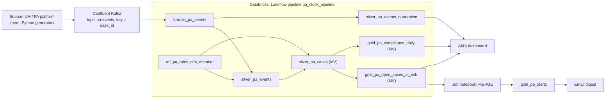

# PA Clock: Prior Authorization Turnaround Monitor

Near-real-time monitoring of prior authorization (PA) decision deadlines for a health plan (payer),
built on Kafka and Databricks Lakeflow Spark Declarative Pipelines. Synthetic data only; no PHI.

## 1. Problem statement

Under CMS-0057-F, impacted payers (Medicare Advantage, Medicaid and CHIP managed care and FFS programs, with some
exceptions such as QHP issuers on the federal exchanges) must send PA decisions within **72 hours for expedited**
requests and **7 calendar days for standard** requests for medical items and services (excluding drugs), beginning
in 2026. They must also publicly report annual PA metrics, starting March 31, 2026.

The operational problem: utilization management (UM) teams usually find out a case missed its window **after** it
happened, from spreadsheets or end-of-week reports. A deadline breach is the *absence* of an event, so it is hard to
see in a transactional system. PA Clock turns the PA event stream into a live view of "which open cases are about to
breach, and by how much", raises one alert per case and risk band, and keeps the data needed for the public metrics.

## 2. Scope and simplifications

- Medical PA only. Pharmacy (Rx) PA is out of scope: different rules and a different data flow.
- The clock starts at the `SUBMITTED` event and does not pause for information requests. Real rules about pauses and
  extensions vary by program and state; model them in `ref.ref_pa_rules` if needed.
- Calendar-time hours; no business-day or holiday logic.
- Data is generated by a Python script that writes JSON events to Kafka.

## 3. Architecture



Orchestration: a Lakeflow Job runs task 1 (refresh the pipeline) and then task 2 (the `send_alerts` notebook).

## 4. Tables (9)

| Layer | Table | Type | Purpose |
|---|---|---|---|
| ref | `ref.ref_pa_rules` | Delta table | Decision window per line of business and urgency, risk thresholds, effective dates |
| ref | `ref.dim_member` | Delta table | 200 synthetic members with line of business and state |
| bronze | `bronze.bronze_pa_events` | Streaming table | Raw Kafka payload plus topic, partition, offset, timestamp, ingestion time |
| silver | `silver.silver_pa_events` | Streaming table | Parsed, typed, de-duplicated, validated events, enriched with line of business |
| silver | `silver.silver_pa_events_quarantine` | Streaming table | Records that failed validation, with a reason |
| silver | `silver.silver_pa_cases` | Materialized view | One row per case, rebuilt from all events, with `due_ts` |
| gold | `gold.gold_pa_open_cases_at_risk` | Materialized view | Open cases with hours elapsed/remaining and risk band |
| gold | `gold.gold_pa_alerts` | Delta table (job-managed) | One alert per case and risk band, with notification state |
| gold | `gold.gold_pa_compliance_daily` | Materialized view | Daily decided cases, approval mix, turnaround, on-time % |

## 5. Event contract

One JSON object per Kafka message, keyed by `case_id` (so a case's events stay ordered within a partition).

```json
{"event_id":"e-11211310-000123","case_id":"PA-11211310-0045","event_type":"SUBMITTED",
 "event_ts":"2026-11-21T09:15:00Z","member_id":"M00023","provider_npi":"1234567890",
 "service_code":"72148","urgency":"STANDARD","reviewer_id":null,"decision":null}
```

- `event_type`: `SUBMITTED`, `INFO_REQUESTED`, `INFO_RECEIVED`, `DECIDED` (with `decision` APPROVED / DENIED / PARTIAL), `WITHDRAWN`.
- `urgency`: `STANDARD` or `EXPEDITED`.
- Validation rules (silver): event_id, case_id and a parseable event_ts present; known event_type; known urgency.

## 6. Business rules

| Line of business | Urgency | Window | WARNING at | CRITICAL at | BREACHED at |
|---|---|---|---|---|---|
| MA, MEDICAID, CHIP | EXPEDITED | 72 h | 54 h (75%) | 65 h (90%) | 72 h |
| MA, MEDICAID, CHIP | STANDARD | 168 h | 126 h (75%) | 151 h (90%) | 168 h |

`due_ts = submitted_ts + hours_allowed`. A case is open until a `DECIDED` or `WITHDRAWN` event exists.
Thresholds are configurable in `ref.ref_pa_rules`.

## 7. Key design decisions

1. **Bronze keeps everything raw** (including duplicates and bad records) so the pipeline is replayable.
2. **De-duplication** uses `withWatermark("ingested_at", "1 day")` + `dropDuplicatesWithinWatermark(["event_id"])`.
   The watermark is on ingestion time, not event time, because events can legitimately arrive days late and an
   event-time watermark could discard them.
3. **Quarantine instead of silent drop.** The same validation rules drive an expectation (drop from silver, with
   metrics) and an inverse filter that writes the failing rows plus a `reason` to the quarantine table.
4. **Stream-static join** of events to `ref.dim_member` (small, broadcast) adds line of business.
5. **`silver_pa_cases` is a materialized view, not CDC.** The generator sends some events late and out of order.
   With CDC sequenced by event time, a late `SUBMITTED` (older than an already-applied `DECIDED`) would be ignored and
   the case would lose its start time. Rebuilding each case from all of its events is robust to ordering.
6. **Risk is time-based, so it cannot be a pure stream.** A breach is the absence of an event. The gold view uses
   `current_timestamp()` and is recomputed on every refresh; the Job's schedule (or manual run) sets how fresh it is.
7. **Alerts are idempotent.** The notebook `MERGE`s on `alert_id = case_id | risk_band`, so each threshold is raised
   once. Email is a digest (counts plus the 15 most urgent), sent only for alerts with `notified = false`, which are
   then marked as notified.

## 8. Runtime configuration (lives in the Databricks workspace, not in Git)

- Pipeline `pa_clock_pipeline`: root `src/pipeline/pa_clock_pipeline`, source `transformations/`, default schema `bronze`, serverless.
- Job `pa_clock_alerts_job`: `refresh_pipeline` (pipeline task) then `send_alerts` (notebook `src/jobs/01_send_alerts`, parameters `catalog`, `send_email`).
- Secret scope `pa_clock_scope`: `kafka-bootstrap`, `kafka-api-key`, `kafka-api-secret`, `smtp-user`, `smtp-app-password`, `alert-to`.
- Never commit credentials. Secrets are created from a scratch notebook outside the Git folder.

## 9. Git workflow

Feature branch per step, PR into `develop` on GitHub, merge, pull `develop` in the Databricks Git folder.
Databricks cannot delete branches; delete merged branches in GitHub. Pipelines and jobs run the files in the Git
folder's **checked-out branch**, so keep it on `develop` for normal runs.

| Branch | Content |
|---|---|
| `feature/01-setup-ref-tables` | Schemas, `ref_pa_rules`, `dim_member` |
| `feature/02-event-generator` | Kafka connectivity check, event generator |
| `feature/03-bronze-silver` | Bronze, silver events, quarantine, silver cases |
| `feature/04-gold-alerts` | Gold views, alert notebook, README setup notes |

## 10. Repo layout

```
src/setup/        00_setup (schemas, reference tables)
src/generator/    01_kafka_check, 02_pa_event_generator
src/pipeline/pa_clock_pipeline/transformations/
                  01_bronze.py, 02_silver_events.py, 03_silver_cases.sql, 04_gold.sql
src/jobs/         01_send_alerts
docs/             design.md
```

## 11. Runbook

1. Run the generator (`mode = send`) to publish fresh cases.
2. Run `pa_clock_alerts_job` (refreshes the pipeline, then raises alerts and emails the digest).
3. Open the dashboard; check the quarantine page for rejected records.
4. Re-running the Job with no new data and no band changes prints `No new alerts.`

## 12. Data generator scenarios

About 300 cases per run, weighted: decided on time 45%, decided late 8%, withdrawn 8%, open on track 15%, open
warning 10%, open critical 8%, open breached 6%. Roughly 25% of cases are expedited. About 35% of eligible cases include an
info-request round trip. Injected mess: about 5% duplicate events, about 8% of cases with a late-arriving first event
(out of order), about 2% malformed records (missing `case_id` or unknown `event_type`).

## 13. Expected business benefits (illustrative model, not measured results)

All inputs below are **assumptions** for a hypothetical 300,000-member regional plan; replace them with your own data.
Anchors: KFF reports Medicare Advantage insurers made about 53 million PA determinations in 2024 (49.8 million in 2023),
and nearly two determinations per MA enrollee in 2023. The blended rate here (0.4 / 0.6 / 1.0 per member) is lower
because Medicaid and CHIP use PA less than MA.

| | Conservative | Base | Optimistic |
|---|---|---|---|
| PA decisions per year | 120,000 | 180,000 | 300,000 |
| Late rate before | 2% | 4% | 7% |
| Reduction in late decisions | 30% | 50% | 70% |
| Late decisions avoided per year | 720 | 3,600 | 14,700 |
| Internal cost per late decision | $15 | $35 | $60 |
| Supervisor tracking time saved | 8 h/week | 15 h/week | 25 h/week |
| Reporting prep time saved | 80 h/year | 200 h/year | 350 h/year |
| **Annual benefit** | **$40k** | **$184k** | **$980k** |
| Net, year 1 (cost $100k) | -$60k | +$84k | +$880k |
| Net, ongoing (cost $46k/year) | -$6k | +$138k | +$934k |

Reading it honestly: if your plan already decides almost everything on time, or is small, the measurable savings do
not cover a production build; the case then rests on compliance risk reduction and audit readiness. In the base case,
12-month payback needs about 1,200 avoided late decisions per year. The PDF companion has the sensitivity grid.

Not quantified: reduced regulatory and audit exposure, provider and member experience, and faster response to
backlogs. Validate the model with a pilot: baseline late rate, median time from WARNING alert to decision, and
alert precision (alerts that led to action).

## 14. Limitations and production roadmap

- Replace the generator with the real UM/PA feed (often X12 278 or FHIR Prior Authorization API events) and add Schema Registry.
- Model clock pauses, extensions, business calendars, and state-specific Medicaid timeframes in the rules table.
- PHI controls: Unity Catalog row/column masking, audit, retention, encryption, HIPAA review.
- Reliability: dead-letter handling beyond the quarantine table, alert acknowledgement, on-call routing instead of email.
- Environments and CI/CD: Declarative Automation Bundles with dev/test/prod targets and automated tests.
- Free Edition constraints (serverless only, limited outbound access, one active pipeline per type) do not apply to a production workspace.
- Drug PA timeframes (CMS-0062-P, proposed) could be added as new rules rows.

## 15. References

- CMS, Prior Authorization API and decision timeframes: https://www.cms.gov/prior-authorization-api
- CMS, CMS-0057-F press release (about $15 billion estimated savings over ten years for the full rule): https://www.cms.gov/newsroom/press-releases/cms-finalizes-rule-expand-access-health-information-improve-prior-authorization-process
- CMS, PA metrics reporting template: https://www.cms.gov/files/document/prior-authorization-metrics-reporting-overview-template.pdf
- KFF, Medicare Advantage PA determinations in 2024: https://www.kff.org/medicare/medicare-advantage-insurers-made-nearly-53-million-prior-authorization-determinations-in-2024/
- Databricks docs: Git folders, Lakeflow Spark Declarative Pipelines, Free Edition limitations
